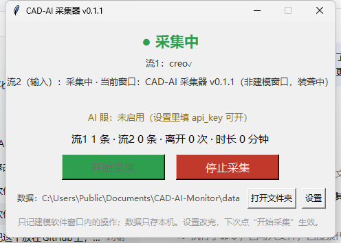

# CAD-AI Collector — record how you actually model (English)

**English** | [中文](README.md)

[](LICENSE)

[](https://github.com/langyouzhe/CAD-AI-Monitor/actions/workflows/ci.yml)

A local-first collector that records *how* you actually model in SolidWorks / Creo / NX: software events, your real mouse & keyboard actions, and optional AI vision on top. Built so an AI can later learn **your personal modeling style**. All data stays on your own machine.

> ⚖️ **Trademark notice** — This is an independent personal project. It is **not affiliated with, authorized, sponsored or endorsed by** Dassault Systèmes, PTC, Siemens or their affiliates. SolidWorks®, Creo® and NX™ are trademarks of their respective owners and are named here **only to describe compatibility**. The tool reads data that these applications themselves produce or expose locally (COM interface, Creo trail files, NX recorded journals). It does not modify, crack or bypass any software licensing.

> 🏷️ **Versioning** — Public releases follow semantic versioning; the current release is **v0.2.1** (`0.x` = early, interfaces may still change). Labels such as *v2* / *v3* / *v4* that appear in code comments or the Chinese documentation are **internal development generations** (2nd architecture → 3rd adds vision → 4th adds per-session storage), not release versions.

> 🔒 **Privacy** — This program is technically a keyboard/mouse recorder, so please read [PRIVACY.md](PRIVACY.md) before using it. Short version: it only records while a CAD window is in front, everything is stored locally, and the only network activity is the optional AI Eye that you enable with your own API key.

## What it does



*The collector while running (Creo attached; the collector's own window is in front here, so stream 2 is "deaf" and records nothing).*

Double-click it, model normally, and it logs a timestamped, multi-stream record to local files:

| Stream | What it captures | Examples |
|---|---|---|
| **Stream 1 (hands)** | Model changes reported by the CAD's own interface: which document is open, **which face/edge/feature you selected**, feature-tree additions/removals, executed commands | SolidWorks: `selectionChanged`; Creo: `creo_trail` (menu/command log); NX: `nx_journal` (`Menu:` comments + NXOpen calls from the recorded journal) |
| **Stream 2 (eyes)** | What you physically did inside the CAD window: clicks, keys, shortcuts, **gestures (button drags)** | `key_down` (local lookup turns `s` into a command name), `gesture` (direction + command id) |
| **Stream 2 · AI Eye** | On a trigger, screenshots the **whole CAD window** and asks your vision model what happened; the answer is stored on the original event's timestamp | `data\sessions\<start time>\images\` keeps the JPEGs |
| **Reconciliation** | On stop, cross-checks action ↔ stream-1 effect ↔ vision result and flags missing evidence as `meta/anomaly` | `stream2_no_effect`, `stream1_orphan`, `visual_missing`, `visual_failed` |
| **meta** | Session start/stop and leave/return markers (no idle events) | idle threshold is configurable |

## Core rules

1. **Deaf mode (装聋)** — input is only recorded while a configured CAD window is in the foreground. Switch to a browser and it stops immediately.
2. **No pause events** — every row carries a timestamp; idle time is just the gap between rows.
3. **Screenshots are your call** — with `save_images: true` (default) JPEGs are kept in the current session's `images\` folder (`data\sessions\<start time>\images\`); set it to `false` and screenshots never touch the disk.
4. **Local only** — no server, no account, no telemetry. The single optional network call is the AI Eye (see [PRIVACY.md](PRIVACY.md)).

## How to use

1. Start SolidWorks (or Creo / NX — whatever is running gets picked up automatically).
2. **Download and run** `CAD-AI-Collector.exe` from the **Releases** section on the right (no Python needed) → click **开始采集 (Start)** → model normally → **停止采集 (Stop)**.
   <br>(Want to run from source instead? See the repository layout below; to build the exe yourself, use `app\build.bat`.)
3. The window shows, live: which backends connected, whether the foreground window counts as a modeling window, and AI Eye statistics.

No paths or versions to configure: the program **auto-discovers** your installation (see below).

## Where your data lives

Resolution order (first match wins): `CAD_AI_MONITOR_DATA` env var → `data\` next to the exe (portable) → `Documents\CAD-AI-Monitor\data\`.

**Since v0.2.0, one collection run = one folder** (nothing is mixed into a shared file anymore):

```
data\sessions\2026-10-19_122035\   start-time folder name (local time; _2/_3 on collision)
├─ images\                         AI Eye screenshots of this session (JPEG, flat)
├─ data\events.db                  SQLite; tables `sessions` and `events` (ts_ms | ts_iso | source | kind | detail)
└─ session.json                    summary: app version, start/stop time, CAD software, event count, schema version
```

- **Empty sessions leave no trace** — a normal stop that recorded nothing except the start/stop markers deletes the whole folder.
- **Interrupted sessions are kept** — on the next launch, sessions with an empty `sessions.stopped_at` are preserved, WAL-checkpointed and marked `"status": "aborted"` in `session.json`.
- **Cross-session access** — walk `data\sessions\*\data\events.db`, or use the helper: `python app\collector_core.py` (add `--json` / `--events` for machine-readable output).
- **Single instance** — launching a second copy shows “已在采集中” (already collecting) and exits, so two processes never write the same data.
- The bottom bar shows the current session folder; **打开文件夹 (Open folder)** opens it.

### Upgrading from v0.1.x

> Close the old collector before running the new version (so the old process is not still holding the old database).

On the first launch of v0.2.0, the old data is **moved, never deleted**:

```
data\legacy\events_legacy.db     old data\events.db
data\legacy\images\...           old data\images\ (same relative layout)
data\legacy\migration.log        migration log
```

The absolute screenshot paths stored inside the old database are rewritten to the new location, so old screenshots keep working. The migration is idempotent (never overwrites an existing archive), rolls back to the untouched state on failure, and logs the outcome. To roll back: close the app, rename `data\legacy\events_legacy.db` back to `data\events.db` and `data\legacy\images\` back to `data\images\`.

## Supported versions (auto-discovery, no hard-coded versions)

| Software | Status | How it connects |
|---|---|---|
| SolidWorks **2022** | ✅ tested by the author | COM; tries the version-independent `SldWorks.Application` first, then enumerates `SldWorks.Application.*` |
| Creo Parametric **12.4** | ✅ tested by the author | parses the Creo trail file, located through the shortcut's *Start in* folder |
| NX (any version) | ✅ tested on 2512 / 2406 | reads the `.cs/.py` file produced by NX **Record Journal** (`Menu:` comments + NXOpen calls); you must record a journal first (see “NX users: record a journal”) |
| Other SolidWorks versions (2015–2025) | ⚪ should work, unverified | same mechanism; shortcut/gesture registry keys are enumerated per version |
| Other Creo versions (7–11) | ⚪ should work, unverified | same mechanism; trail format is stable across versions |
| Inventor / AutoCAD / Solid Edge / FreeCAD / Fusion | ⚪ stream 2 only | keyboard/mouse + AI Eye still work; stream 1 needs a dedicated bridge |

> **NX users — record a journal**: stream 1 reads the file produced by NX **Record Journal** (`.cs/.py`), not syslog. In NX use `File → Utilities → Record Journal` (or `Tools → Journal → Record`) and save it to Desktop/Documents/`data\journals`; the collector picks the newest one, or set `nx.journal_path`. syslog is a crash-diagnostic log and is no longer used.

What auto-discovery looks at:

- **SolidWorks**: `SldWorks.Application` (version independent) → `SldWorks.Application.NN` newest first → registry `HKCU\Software\SolidWorks\SOLIDWORKS <year>`
- **Creo**: the shortcut's working directory (that is where trail files are written) → `trail_dir` from `config.pro` → home/Documents/Desktop
- **NX**: `nx.journal_path` (explicit file, most reliable) → Desktop/Documents/Downloads/`data\journals`, filtered by content signature (no more syslog)
- **Modeling-window list**: 13 mainstream CAD executables built in; editable via `modeling_apps`

## Settings

`config.json` is created automatically in the data folder on first run; `config.example.json` in the repo shows every option. The most useful ones:

| Setting | Default | Meaning |
|---|---|---|
| `modeling_apps` | 13 CAD entries | which windows count as modeling windows |
| `idle_minutes` | `5.0` | idle time before a "leave" marker |
| `stream1.backends` | `["solidworks","creo","nx"]` | which CAD backends to run |
| `stream1.prog_id` | empty = auto | SolidWorks COM ProgID override |
| `creo.trail_dirs` / `nx.journal_path` / `nx.journal_dirs` | empty = auto | manual override for the Creo trail or the NX recorded journal (`.cs/.py`); `nx.journal_path` is the most reliable |
| `creo.stale_minutes` | `10` | warn when the attached trail file stops updating |
| `ai_eye.enabled` | `false` | master switch for the AI Eye |
| `ai_eye.provider` | `mock` | `mock` / `zhipu` / `qwen` / `doubao` / `custom` |
| `ai_eye.api_key` | empty | **your** API key (BYOK) |
| `ai_eye.save_images` | `true` | keep screenshots in the session's `images\` folder |
| `ai_eye.drain_timeout_s` | `5.0` | on stop, how long to wait for in-flight cloud requests before closing the database |
| `ai_eye.triggers` | left click, shortcut, letter key, gesture on | what fires a screenshot |
| `ai_eye.rate_per_min` | `60` | screenshot rate limit |
| `reconcile.window_ms` | `2000` | how long after an action a stream-1 event still counts as its effect |

## Enabling the AI Eye (your key, your bill)

1. Register with a vision-model provider (Zhipu `open.bigmodel.cn`, Alibaba Bailian, Volcano Engine, or any OpenAI-compatible service) and copy an API key.
2. Open the settings dialog (or `config.json`): set `ai_eye.enabled` to `true`, fill `api_key`, set `provider` accordingly (`zhipu` / `qwen` / `doubao` / `custom`) and `model` to a **vision** model (e.g. Zhipu `glm-4v-flash`, Qwen `qwen-vl-plus`).
3. Start collecting. Cost is roughly ¥0.01–0.05 per image, capped at `rate_per_min`.

⚠️ **Do not set `model` to `deepseek-flash`**: DeepSeek's public API only serves text models (`deepseek-chat` / `deepseek-reasoner`), so it cannot read images — and `deepseek-flash` is not a valid public model name (issue discovered 2026-10-23). Use a multimodal provider. To keep the key out of `config.json`, set the `AI_EYE_KEY` environment variable (it takes precedence).

## Run or build from source

```bat
git clone https://github.com/langyouzhe/CAD-AI-Monitor.git
cd CAD-AI-Monitor
python -m pip install -r app\requirements.txt

python app\app.py          :: run from source
python app\selftest.py     :: 25 self-tests, no CAD required
app\build.bat              :: build release\CAD-AI-Collector.exe
release\CAD-AI-Collector.exe --selftest   :: exit code 0 = healthy
```

Tested with Python 3.12 on Windows 11. `build.bat` finds Python by itself (override with `set CADAI_PYTHON=...`). Software-specific live tests: `python app\selftest_solidworks.py`, `selftest_creo.py`, `selftest_nx.py`, `selftest_ai_eye_live.py` (the last one needs a real API key).

## Troubleshooting

| Symptom | Answer |
|---|---|
| Windows SmartScreen blocks the exe | Expected for unsigned executables: **More info → Run anyway**. Or build it yourself from source. |
| Antivirus flags it | Global input hooks look like a keylogger to heuristics. The full source is here; build it yourself if you prefer. |
| Stream 1 is empty | The status line now tells you why: "trail file not found" (Creo never ran) or "trail file has not updated for N minutes" (the bridge attached to a dead file — set `creo.trail_dirs` manually). |
| Creo trail file location | It is in the shortcut's *Start in* folder (e.g. `C:\Users\Public\Documents`). ⚠️ The `trail.txt.1` inside the PTC install directory is a **sample shipped by PTC**, not your work — the bridge no longer mistakes it for the real one. |
| NX has no data | Stream 1 now reads the **NX Record Journal** file (`.cs/.py`), not syslog (syslog is a crash-diagnostic log with no modeling operations). Record a journal in NX (`File → Utilities → Record Journal`) and save it to Desktop/Documents/`data\journals`; the collector auto-detects the newest one, or set `nx.journal_path`. |
| Gesture command names are missing | Gesture **direction** is always recorded. The command-ID → name table is generated **on first run from your own SolidWorks type library** (`swcommands.tlb`) into `data\sw_command_ids.json` — it is not redistributed with this repository. On SW2022 the type-library numbering does not match the legacy IDs stored in the registry, so names may stay empty; fill them in via `data\sw_shortcut_map.json`, or run `python app\sw_shortcuts.py --generate data` to build the table ahead of time. |
| I want to delete my data | Close the app and delete the data folder, or just one `data\sessions\<start time>\` session folder. `data\legacy\` holds archived pre-v0.2.0 data — check twice before deleting it. |
| Where did my old (v0.1.x) data go? | It was moved — never deleted — to `data\legacy\` on the first v0.2.0 launch (`events_legacy.db` + `data\legacy\images\`, paths rewritten so screenshots still open). See “Upgrading from v0.1.x” above. |
| A second launch says “已在采集中” | Only one instance may write data at a time. Switch to the already-open window instead of launching another copy. |

## Known limitations

1. **Windows only.** It relies on Win32 COM, global input hooks and Windows registry.
2. **NX uses the recorded journal** (since 2026-10-23). syslog contained only startup/crash diagnostics; a probe of four sessions found zero modeling events. Record a journal in NX (or set `nx.journal_path`); auto-starting the recording from the collector is the next step (not done yet).
3. **Reconciliation is advisory.** `stream2_no_effect` may just be a view-only click; nothing is deleted automatically. When stream 1 has no source at all, reconciliation is skipped and a single `meta/stream1_unavailable` marker is written instead of one false anomaly per click.
4. **AI Eye requires a multimodal model.** DeepSeek's public API (`deepseek-chat`/`deepseek-reasoner`) is text-only and `deepseek-flash` is not a valid model name; use Zhipu `glm-4v-flash`, Qwen `qwen-vl-plus`, etc.
5. **No code signature.** Expect SmartScreen warnings; each release lists a SHA-256 checksum so you can verify the download.
6. **Data is not de-identified.** Do not publish a collected `data\` folder (or session folder) without reviewing it.
7. **v0.2.0 changed the storage layout.** If you wrote scripts that read the single `data\events.db`, walk `data\sessions\*\data\events.db` instead (or use `python app\collector_core.py --json`). Pre-v0.2.0 data lives in `data\legacy\`.

## Repository layout

| Path | Responsibility |
|---|---|
| `app\collector_core.py` | config + per-session storage (v4) + legacy archive / crash recovery + cross-session summary CLI |
| `app\cad_discovery.py` | CAD auto-discovery (ProgIDs, registry versions, trail/journal folders, NX executable lookup, CAD app list) |
| `app\input_listener.py` | stream 2: hooks, deaf mode, gestures, leave/return, AI Eye triggers |
| `app\solidworks_bridge.py` | stream 1 · SolidWorks (COM snapshots + diff) |
| `app\creo_bridge.py` | stream 1 · Creo (trail parsing, mapkeys) |
| `app\nx_bridge.py` | stream 1 · NX (recorded-journal tailing + menu/API parsing) |
| `app\journal_parser.py` | NX journal parser (`Menu:` comments + NXOpen calls; UTF-16/UTF-8 auto-detect) |
| `app\ai_eye.py` | screenshot → your vision model → event store |
| `app\reconcile.py` | three-way reconciliation |
| `app\sw_shortcuts.py` | SolidWorks shortcut/gesture mapping; generates the command-ID table locally from your own SW type library |
| `app\app.py` | Tkinter GUI and settings dialog |
| `app\selftest*.py` | self-tests and per-CAD live tests |
| `config.example.json` | every configuration option, no secrets |

## License

[MIT](LICENSE) © 2026 langyouzhe.

## Contributing

The most valuable contribution is not code — it is *"I ran it on my CAD version, here is
what happened"*. One short issue moves a row of the support matrix from *unverified* to
*tested*.

- Development setup, the rules we hold to (no hard-coded paths or versions, ASCII-only
  batch files, never commit personal data) and how to add a new CAD backend:
  [CONTRIBUTING.md](CONTRIBUTING.md)
- What changed in each release: [CHANGELOG.md](CHANGELOG.md)
- Found a bug? Please use the [issue template](.github/ISSUE_TEMPLATE/bug_report.md) — it
  asks for your CAD version and the status-line text, which is usually what makes a bug
  reproducible.
